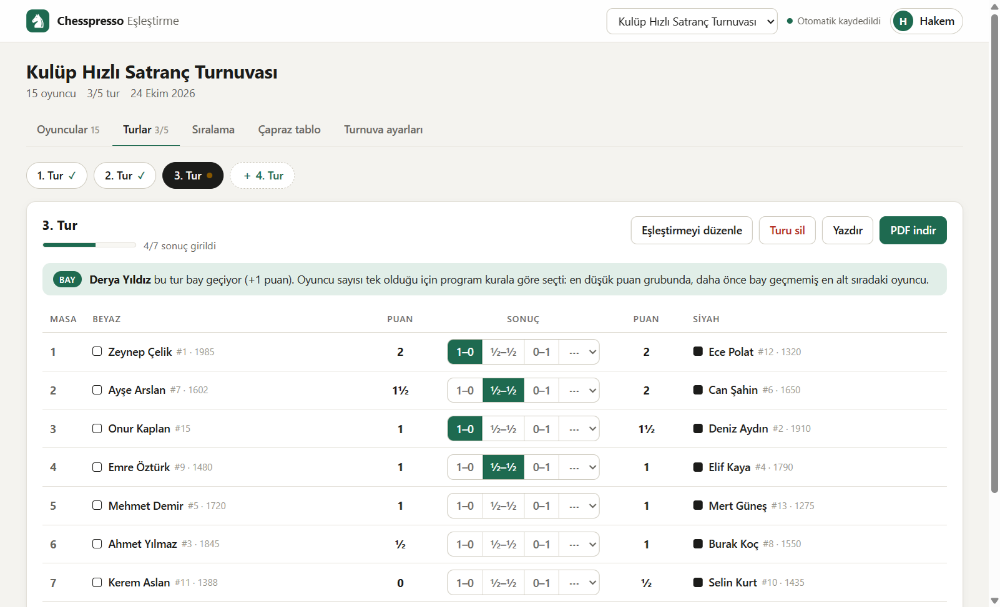
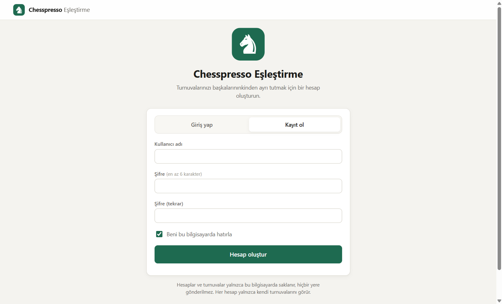
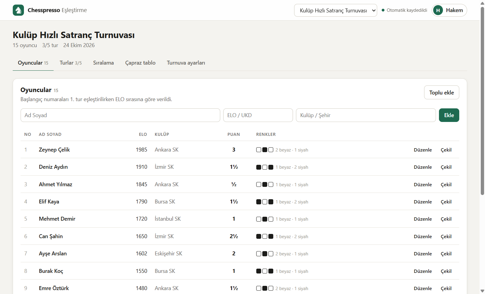
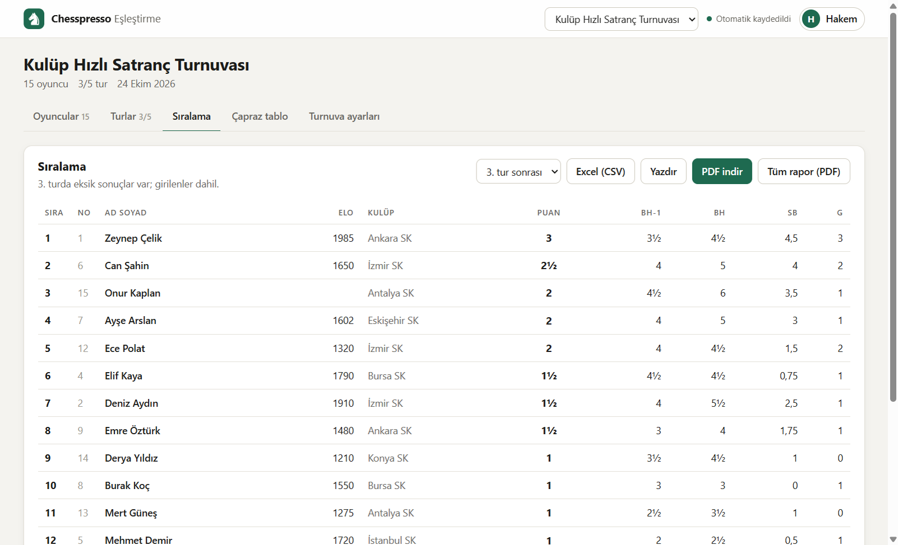

<p align="center">
  
</p>

<h1 align="center">Chesspresso Eşleştirme</h1>

<p align="center">
  İsviçre sistemi satranç turnuvaları için ücretsiz, Türkçe eşleştirme ve sıralama programı.<br>
  İnternet gerektirmez · Kişisel hesaplar · Windows, macOS ve Linux
</p>

<p align="center">
  <a href="https://etgazavalsiz.github.io/chesspresso-eslestirme/"><b>▶ Hemen kullan / bilgisayara yükle</b></a>
  &nbsp;·&nbsp;
  <a href="https://github.com/etgazavalsiz/chesspresso-eslestirme/releases/latest">⬇ Windows kurulum dosyası</a>
  &nbsp;·&nbsp;
  <a href="#eşleştirme-kuralları">Eşleştirme kuralları</a>
</p>



## Kurulum

### Yol 1 — Tarayıcıdan yükle (önerilen, güvenlik uyarısı çıkmaz)

1. **Edge** veya **Chrome** ile şu adresi açın: **https://etgazavalsiz.github.io/chesspresso-eslestirme/**
2. Sağ üstteki **“Uygulamayı yükle”** düğmesine (veya adres çubuğundaki yükle simgesine ⊕) tıklayın.
3. Chesspresso kendi penceresinde açılır; masaüstüne ve Başlat menüsüne kısayolu eklenir.

Bu şekilde yüklenen uygulama **internet olmadan da çalışır** ve yeni sürümler çıktığında **kendiliğinden güncellenir**. Hiçbir dosya indirmediğiniz için Windows güvenlik uyarısı da çıkmaz. Kaldırmak için uygulama penceresinin sağ üstündeki **⋯ → Kaldır**'ı kullanın.

### Yol 2 — Windows kurulum dosyası

1. [Son sürüm sayfasından](https://github.com/etgazavalsiz/chesspresso-eslestirme/releases/latest) **`Chesspresso-Kurulum-x.y.z.exe`** dosyasını indirip çalıştırın.
2. Türkçe kurulum sihirbazı açılır: **kimin için kurulsun → klasör → Kur → Bitir**. Yönetici izni gerekmez.
3. Masaüstünde ve Başlat menüsünde **Chesspresso Eşleştirme** kısayolu oluşur.

> **“Windows kişisel bilgisayarınızı korudu” uyarısı:** Kurulum dosyası ücretli bir kod imzalama sertifikasıyla imzalanmadığı için, internetten indirilen her yeni program gibi Windows SmartScreen bu uyarıyı gösterir. **Ek bilgi → Yine de çalıştır** ile devam edebilirsiniz. Uyarıyla hiç karşılaşmak istemiyorsanız **Yol 1**'i kullanın.

Eski 1.0.0 sürümü kuruluysa yeni kurulum onu kendiliğinden kaldırır; turnuva kayıtlarınız silinmez. **Kaldırmak için:** Ayarlar → Uygulamalar → *Chesspresso Eşleştirme* → Kaldır.

### Yol 3 — Tek dosya

Tüm program [`index.html`](index.html) dosyasıdır. İndirip herhangi bir tarayıcıda açabilirsiniz (macOS ve Linux dahil).

## Hesaplar

| Giriş ekranı | Oyuncular ve renk geçmişi |
|---|---|
|  |  |

- İlk açılışta bir **hesap oluşturun** (kullanıcı adı + şifre). Her hesap **yalnızca kendi turnuvalarını** görür; aynı bilgisayarı birden çok hakem kullanabilir.
- Hesap açarken bir **kurtarma kodu** gösterilir. Şifrenizi unutursanız giriş ekranındaki **“Şifremi unuttum”** ile bu kodla yeni şifre belirlersiniz. Kodu bir yere not edin.
- Hesaplar ve turnuvalar **yalnızca o bilgisayarda** (tarayıcıdan yüklediyseniz o tarayıcıda) saklanır, internete gönderilmez. Şifreler düz metin olarak değil, PBKDF2 ile özetlenerek tutulur.
- Hesaplardan önceki bir sürümde oluşturulmuş turnuvalar kimseye kendiliğinden gösterilmez; giriş yapan kullanıcıya **“Hesabıma aktar”** seçeneği sunulur.
- Başka bilgisayara geçmek için: **Turnuva ayarları → Yedek indir (.json)**, diğer bilgisayarda **Yedekten yükle**.

## Özellikler

- **Otomatik İsviçre eşleştirmesi** — Puan grupları, Hollanda (Dutch) sistemi mantığı, tekrar eşleşme yok, renk dengesi, otomatik bay. Her tur tek tıkla.
- **Sonuç girişi** — 1–0, ½–½, 0–1 ve hükmen sonuçlar (+/−, −/+, −/−).
- **Sıralama ve averajlar** — Buchholz, Buchholz Kesik-1, Medyan Buchholz, Sonneborn-Berger, aralarındaki maç, galibiyet sayısı, siyahla oynanan, kademeli puan, rakip ELO ortalaması. Sırasını siz belirlersiniz.
- **Çapraz tablo** ve oyuncuların tur tur **renk geçmişi**.
- **PDF indirme** — Tur eşleştirmesi/sonuçları, sıralama, çapraz tablo ve tüm turnuva raporu. Türkçe karakterler sorunsuz.
- **Excel (CSV)**, yazdırma, yedekleme (.json) ve yedekten yükleme.
- **Katılım yönetimi** — Tura gelmeyecek oyuncuları "izinli (½)" veya "gelmeyecek (0)" işaretleyin; turnuvadan çekilme, geç katılım.
- **Elle düzenleme** — Gerekirse eşleştirmede iki oyuncunun yerini veya bir masanın renklerini değiştirin.
- **Birden çok turnuva**, açık ve koyu tema.



## Hızlı başlangıç

1. **Hesap oluşturun**, ardından **turnuva oluşturun** — ad ve tur sayısı (oyuncu sayısı N ise en az log₂N tur önerilir; 16 oyuncu → 4–5 tur).
2. **Oyuncuları ekleyin** — Tek tek ya da Excel'den toplu yapıştırarak (`Ad Soyad, ELO, Kulüp`). Başlangıç sırası ELO'ya göre otomatik belirlenir.
3. **Turlar → "1. turu eşleştir"** — Oyuncu sayısı tekse bayı program seçer ve son masaya ekler.
4. **Sonuçları girin**, sonraki tura geçin. Sıralama ve averajlar anında güncellenir.
5. **PDF indir** ile eşleştirmeyi duvara asın, turnuva sonunda **Tüm rapor (PDF)** alın.

## Eşleştirme kuralları

Program FIDE'nin Hollanda (Dutch) sistemi kurallarını öncelik sırasına göre ağırlıklara çevirir ve Edmonds'un en büyük ağırlıklı eşleşme ("blossom") algoritmasıyla tüm olasılıklar arasından en iyi eşleştirmeyi tek seferde bulur; çıkmaza girmez.

1. **Tekrar yok:** İki oyuncu ikinci kez karşılaşmaz (hükmen maçlar oynanmamış sayılır).
2. **Renk:** Kimse aynı renkle üst üste üç kez oynamaz, beyaz–siyah farkı 2'yi geçmez.
3. **Bay:** En düşük puan grubunda, daha önce bay geçmemiş (ve hükmen kazanmamış) en alt sıradaki oyuncu bay geçer. Bay renk sayılmaz.
4. **Puan grupları:** Aynı puandakiler eşleşir; grup tek sayıysa en alttaki oyuncu bir alt gruba kayar. Aynı oyuncunun üst üste kaydırılmasından kaçınılır.
5. **Renk tercihi:** Herkes mümkün olduğunca renk değiştirir.
6. **Sıra:** Grubun üst yarısı alt yarısıyla eşleşir (8 kişilik grupta 1–5, 2–6, 3–7, 4–8).

**Renk önceliği** (Turnuva ayarları):
- **Dengeli (varsayılan):** Bir oyuncunun renk farkı 2'ye çıkacaksa (ör. 4 oyunda 3 beyaz), program onu yakın puanlı başka bir rakiple eşleştirir.
- **FIDE:** Puan grupları her zaman renkten önce gelir.

> Not: Chesspresso FIDE kurallarını yakından izler ancak **FIDE onaylı bir eşleştirme motoru değildir**. Resmî ELO/UKD işlenecek turnuvalarda federasyonunuzun istediği yazılımı kullanın.

## Geliştirme

Uygulamanın tamamı [`index.html`](index.html) içindedir (eşleştirme motoru, PDF üretici, hesaplar ve arayüz; dış kütüphane yoktur). Tarayıcıdan yükleme için [`manifest.webmanifest`](manifest.webmanifest) ve [`sw.js`](sw.js) kullanılır; masaüstü sürümü aynı dosyayı [Electron](https://www.electronjs.org/) penceresinde açar.

```bash
npm install
npm start          # masaüstü uygulamasını geliştirme modunda açar
npm run dist       # Windows kurulum sihirbazını (NSIS) dist/ altına üretir
```

Simgeleri ve kurulum görsellerini yeniden üretmek için: `powershell -File build/make-icon.ps1`

> Windows'ta proje klasörünün yolu çok uzunsa (260 karakter sınırı) kurulum derlemesi hata verebilir; projeyi kısa bir yola koyun (ör. `C:\dev\chesspresso`).

## Teşekkür

En büyük ağırlıklı eşleşme algoritması, Joris van Rantwijk'in `mwmatching.py` uygulamasından JavaScript'e uyarlanmıştır.

## Lisans

[MIT](LICENSE) — özgürce kullanabilir, değiştirebilir ve paylaşabilirsiniz.
